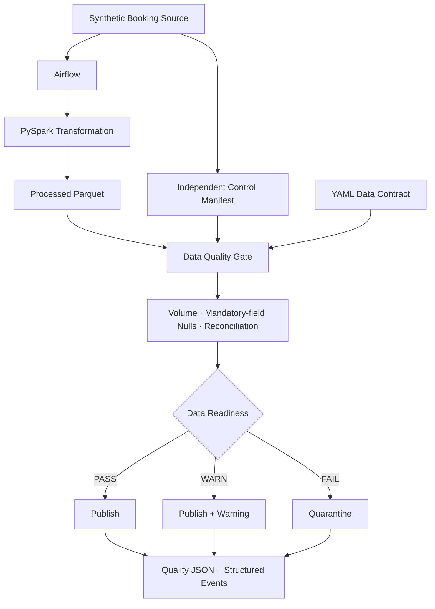

# Green Pipeline, Bad Data

**Reference Implementation · Synthetic / Illustrative travel workload**

> A green pipeline is evidence that processing completed. It is not sufficient evidence that a data product is ready for use.

## The Production Problem

A pipeline can process **100% of what it receives** while the business delivers only **82% of what it should have sent**. Job monitoring sees successful tasks; downstream consumers may see incomplete booking counts, revenue reporting, or demand signals.

**Job Success != Data Correctness**

This implementation separates execution health from data product readiness. A configurable quality gate decides whether a completed dataset belongs in a trusted publication location.

## Failure Scenario

The fictional travel company **Waypoint Travel** expects 100,000 daily bookings from its reservation system. An upstream delivery incident sends only 82,000. Airflow and PySpark successfully process the delivered records. The quality gate identifies the shortfall and routes the output to quarantine.

| Signal | Healthy delivery | Incomplete delivery |
| --- | ---: | ---: |
| Expected bookings | 100,000 | 100,000 |
| Received bookings | 100,000 | 82,000 |
| Completeness | 100% | 82% |
| Airflow DAG | SUCCESS | SUCCESS |
| PySpark transformation | SUCCESS | SUCCESS |
| Data quality | PASS | FAIL |
| Publication | PUBLISHED | QUARANTINED |

No execution or infrastructure failure is injected. The experiment demonstrates successful local processing, not a comprehensive infrastructure health assessment. All records are generated; there is no customer information or claim of a real production incident.

## Architecture



[Architecture and operational boundaries](architecture/architecture.md) explains publication integrity, recovery, and the limits of the local runtime.

## Design Principle

**Execution health** answers: Did the system complete the work it received?

**Data product readiness** answers: Does the resulting dataset meet the agreed conditions for downstream use?

A data quality rejection is a successfully handled business condition. The quality and routing tasks finish successfully when they detect and quarantine bad data. Real execution errors—unreadable files, invalid controls, or failed writes—still fail the task and command. A quality `FAIL` therefore exits successfully only when quarantine succeeds.

## Quality Gate

Rules live in [config/data_contract.yaml](config/data_contract.yaml), with a snapshot retained for each run. Overall severity is the highest of the three checks.

| Check | Measurement | Default decision |
| --- | --- | --- |
| Volume | Received ÷ expected × 100 | PASS at 100%; WARN from 95% to below 100%; FAIL below 95% or above 100% |
| Mandatory fields | Null count ÷ received × 100, per contracted field | FAIL for any null; warning and maximum percentages are configurable |
| Reconciliation | Absolute difference from expected booking amount ÷ expected total × 100 | PASS at zero variance; WARN above zero through 0.5%; FAIL above 0.5% |

The source creates the control total from the **full 100,000-record population before reducing delivery**. It never derives the expected total from the incomplete delivery. The synthetic source and control calculation share a deterministic specification; a real deployment needs an independently governed upstream control source.

Amounts use decimal arithmetic in one currency (USD). Reconciliation is a monetary control, not proof of row-level identity: offsetting errors can preserve the sum. A missing field or invalid control is an execution error; schema evolution and richer business validity rules are outside V1. An empty delivery fails volume and reports 100% null percentage for mandatory fields as an explicit no-data convention.

## Failure Handling

- **PASS → Publish:** copy validated Parquet to `data/published/<run_id>/`.
- **WARN → Publish + warning:** publish with a warning marker and a structured `WARNING` event.
- **FAIL → Quarantine:** copy to `data/quarantine/<run_id>/`; no trusted partition is created for that run.

Publication validates the output fingerprint and stages the copy outside the trusted directory before an atomic rename. Run IDs prevent accidental overwrites, and a completed publication can safely finish reporting on retry. Unfinished staging remains untrusted. Recovery from a failed experiment uses a new run ID; V1 does not implement automatic backfill or replacement of business-date partitions.

## Running the Experiment

Prerequisites: Docker Desktop (or Docker Engine) running with Compose v2, internet access for the first image build, and enough memory for the container's 4 GiB limit. No host Python, Java, Airflow installation, credentials, or cloud account is required.

Clone the repository and run the experiment:

```bash
git clone https://github.com/santosh-sinha-tech/data-platform-production-lab-public.git
cd data-platform-production-lab-public
cd projects/01-green-pipeline-bad-data
docker compose build
docker compose run --rm lab python -m pytest -q
docker compose run --rm lab python -m booking_pipeline.cli healthy --run-id healthy-demo
docker compose run --rm lab python -m booking_pipeline.cli incomplete-source --run-id incomplete-demo
docker compose run --rm lab python scripts/verify_experiments.py
```

Use a new `--run-id` when repeating an experiment, or omit it to generate one automatically. Pass the resulting IDs to the verifier with `--healthy-run` and `--incomplete-run`. Never reuse a run ID to replace a published dataset.

The commands execute a real four-task Airflow DAG through its synchronous **`dag.test()` mode**, using an ephemeral SQLite metadata database inside each one-shot container. They do not deploy a scheduler or web UI. Final JSON includes the actual DAG run ID and four task states, captured before the container is removed. This local mode follows [Airflow's DAG testing documentation](https://airflow.apache.org/docs/apache-airflow/3.3.1/core-concepts/debug.html); SQLite is a [local testing choice, not a production metadata backend](https://airflow.apache.org/docs/apache-airflow/3.3.1/installation/prerequisites.html).

## Expected Results

Healthy scenario:

```text
ORCHESTRATION STATUS: SUCCESS
TRANSFORMATION STATUS: SUCCESS
DATA QUALITY STATUS: PASS
PUBLICATION STATUS: PUBLISHED
RECORDS EXPECTED: 100,000
RECORDS RECEIVED: 100,000
COMPLETENESS: 100.00%
```

Incomplete-source scenario:

```text
ORCHESTRATION STATUS: SUCCESS
TRANSFORMATION STATUS: SUCCESS
DATA QUALITY STATUS: FAIL
PUBLICATION STATUS: QUARANTINED
RECORDS EXPECTED: 100,000
RECORDS RECEIVED: 82,000
COMPLETENESS: 82.00%
```

The full expected booking amount is **USD 54,891,100.00**. The incomplete delivery contains **USD 44,874,730.00**, a signed variance of **−USD 10,016,370.00** (18.2477% absolute variance). These are synthetic control totals, not measured business losses.

Inspect `data/results/<run_id>/quality_result.json` for execution status, quality status, expected and received counts, completeness, field-level null results, reconciliation, publication decision, timestamp, and Airflow task states. A quality report stays `RUNNING` until the CLI observes actual Airflow completion. Operational failures produce `execution_failure.json` when reporting remains possible.

The verifier reads the final reports **and the persisted Parquet**, checks all four Airflow tasks succeeded, and asserts that the incomplete run has no published partition. Generated datasets and runtime reports are intentionally excluded from Git.

See the [executed verification record](architecture/verification.md) for the observed test results and full-size scenario outcomes.

## Observability

Structured JSON events expose `records_expected`, `records_received`, `completeness_percentage`, `mandatory_field_null_percentage`, `reconciliation_variance`, `quality_gate_status`, and `publication_status`. The `observability.emit` function is the integration point for future exporters. Spark and Airflow also emit their own runtime logs; application events are identifiable by the `event` field. Events carry run IDs, not booking payloads.

Execution alerts should identify processing or storage failures. Readiness alerts should identify rejected or degraded datasets and route ownership to the data producer. Incomplete booking data warrants attention even when the DAG is green. Alerting and an observability backend are deliberately not deployed in V1.

## Production Evolution

- **Governed data contracts and schema validation:** versioned rules, ownership, compatibility checks, and independent control provenance.
- **Freshness SLOs:** distinguish late delivery from low volume, with calendar-aware expectations and business cutoffs.
- **Data lineage and catalog integration:** connect readiness evidence to upstream sources and downstream consumers.
- **OpenTelemetry / Prometheus and alerting:** export execution and data-quality signals separately, with actionable ownership and bounded metric cardinality.
- **Replay / backfill:** preserve immutable inputs and add controlled partition replacement, idempotent commits, and lineage between attempts.
- **Cloud object storage:** replace filesystem rename with a manifest/catalog commit protocol and enforce service-identity permissions.
- **Production Airflow:** deploy a supported metadata service, scheduler and executor, operational monitoring, and tested recovery procedures.

These are evolution paths, not implemented capabilities.

## Architecture Trade-offs

**Airflow + PySpark + Parquet** keeps orchestration, transformation, quality decisions, and publication inspectable. Airflow models dependencies and execution states; PySpark provides explicit schemas and decimal aggregation; Parquet makes staged and published outputs directly verifiable. Dependency versions are pinned in the image and requirements; OS packages and transitive dependencies still require routine maintenance.

For 100,000 records, Airflow and Spark add more runtime overhead than a simple Python process needs. They are retained to make familiar production platform boundaries concrete. Spark runs as `local[2]`; there is no distributed Spark cluster. The [Spark installation requirements](https://spark.apache.org/docs/3.5.7/api/python/getting_started/install.html) inform the Java 17 and Python 3.11 container runtime.

Kafka would add streaming semantics to a daily batch problem. Kubernetes and cloud infrastructure would add deployment concerns without strengthening this quality gate demonstration. A full observability stack would obscure the signals being demonstrated. V1 uses one container service, local storage, no network-exposed application ports, and no additional platform services.

The implementation is production-oriented in its failure semantics and explicit controls. Its local execution topology, single-writer filesystem assumption, unsigned control files, and lack of transactional catalog commits are intentional boundaries—not a production deployment blueprint.

## License

This reference implementation is licensed under the [MIT License](../../LICENSE).
