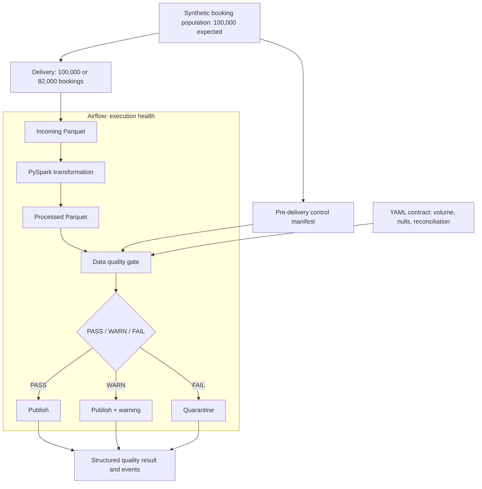

# Architecture and operational boundaries

**Reference Implementation — Synthetic / Illustrative workload**

## Execution boundary

The DAG has four sequential tasks: source, transformation, quality gate, and publication router. The router accepts a quality rejection as an expected result. A missing contract, unreadable Parquet, inconsistent control manifest, changed output, or storage failure is an execution error and propagates to Airflow.

Local execution uses Airflow's `dag.test()` with SQLite and records the actual returned DAG and task states. It does not start a scheduler, API server, or web UI. The CLI only records orchestration success after all four task states are `success`. This proves DAG behaviour; it does not exercise scheduler availability, executor isolation, or a daily schedule. The DAG is manually triggered (`schedule=None`).

## Data and decision boundary

1. Source controls describe the full expected business batch. The source snapshots the YAML contract into the run's control manifest before quality evaluation.
2. Transformation normalizes currency and status and preserves received rows. Amounts use `decimal(18,2)`; there are no floating-point currency aggregates.
3. The gate calculates metrics on processed Parquet and binds the result to a SHA-256 fingerprint of its files. The highest severity across the checks wins.
4. The router validates decision consistency and the fingerprint, copies to a staging directory outside the trusted prefix, verifies the copy, and atomically renames it into published or quarantine on the same local filesystem.
5. A `_publication.json` marker travels with the data. Its underscore prefix keeps Spark from treating metadata as Parquet. The complete quality and execution evidence remains in `data/results/<run_id>/quality_result.json`.

Only the router writes trusted partitions in this implementation. Local users with filesystem write access can bypass it: the fingerprint is an integrity check, not authentication or an access-control system. A production implementation must restrict publication writes to a service identity and protect contract and control provenance.

## Recovery and scope

Each attempt gets a unique run ID. Reusing one is rejected; an incomplete retry cannot overwrite a previous healthy partition. Routing is idempotent after a completed atomic rename. A copy interrupted before rename leaves only untrusted staging; rerun the batch under a new run ID after investigating. Automatic task retries are disabled so source regeneration cannot silently change a batch. No automatic deletion or replacement of published partitions occurs.

Publication and the external result file are not one transaction. The marker inside the dataset is the durable publication evidence. If final reporting fails after publication, the execution fails while the dataset's valid quality disposition remains visible. A retry of the router can recover reporting after a completed rename. Production evolution should add transactional metadata or a catalog commit protocol.

The local mount is a single filesystem, and each run has one writer. There is no cross-process lock, concurrent multi-writer guarantee, object-store rename assumption, or transactional table format. Downstream consumers select completed run directories with a publication marker; there is no automatic daily partition replacement or "latest" pointer. Incoming and processed copies are retained for inspection even when the routed copy is quarantined.
