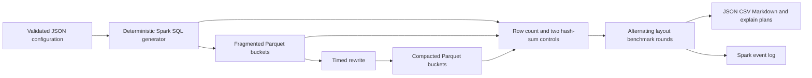

# Architecture and production judgment

## Requirements and assumptions

Local reproducible performance evidence, identical synthetic records, two physical layouts, defensible equivalence controls, configurable sizes, bounded quick defaults and no paid services. Python 3.11, Spark 3.5.8 and Snappy Parquet run on one machine. A single sequential application owns each unique run directory. No concurrent writer or production data is supported. The lab is an experiment rather than a transactional table manager.

## Options and decision matrix

| Option | Spark fidelity | Setup | Metadata/commit behavior | Decision |
|---|---|---|---|---|
| Python/PyArrow microbenchmark | Low for Spark scheduling | Small | Simple files | Reject as primary harness |
| Local Spark + Parquet | High for engine behavior | Java or container | Explicit directories | Choose for portable baseline |
| Delta/Iceberg/Hudi | High | More dependencies | Transactions and maintenance APIs | Later production evolution |
| EMR/Dataproc/managed lakehouse | Real distributed/storage behavior | Credentials and expense | Platform dependent | Outside local scope |

## Final design and deployment

Docker Compose bounds the container to two CPUs and 4 GiB. Spark local[2] shares one JVM and driver; there is no remote executor network. Mount only runs/ for artifacts. Native execution has equivalent engine configuration but different OS/cache behavior. Docker runs as root inside the container; use a rootless runtime or map UID for shared multi-user deployment. No service ports are published.

Generation uses integer hash expressions over event ID plus seed, avoiding Python RNG streams and floating monetary sums. Controlled per-bucket writes keep logical partitioning equal while changing file density. The compacted source is the fragmented data, and rewrite wall time includes its read and write. Validation is separate from rewrite cost. Two salted 64-bit row hashes summed into decimal(38,0), row counts and cents totals are compared with the source. Collisions remain possible; critical migrations need exact multiset comparison or stronger external reconciliation.

## Sizing and expected work

Quick: 60,000 rows / 4 buckets, nominal 48 versus 4 files; about 1,250 versus 15,000 rows/file. Large (optional, not run): 40,000,000 rows / 4 buckets, nominal 1,024 versus 64 files; about 39,063 versus 625,000 rows/file. A planning assumption of 64–128 uncompressed bytes/row gives 3.8–7.7 MB quick and 2.56–5.12 GB large before compression/footer overhead. Actual Parquet bytes and compression differences supersede estimates. Reserve 3 times estimated source bytes for two layouts, shuffle/staging, plus event logs, image and JVM; keep at least 2 GiB free for quick, 20 GiB for large and monitor real usage. These are budgets, not guaranteed maxima.

The scan packing heuristic accounts for data lengths and an estimated 4 MiB per file open within a 128 MiB scan target. As a rough proxy, 48 opens imply about 192 MiB of open-cost weight before data; this is not read bytes or an exact task formula. Spark leaf parallelism and splitting also matter. The harness records actual planned scan RDD partitions outside timing and retains measured task metrics for the whole application. Aggregation introduces exchanges (4 shuffle partitions with AQE disabled), so file count does not equal task count. Two local cores run at most roughly two tasks concurrently. JVM driver heap is configured at 1 GiB, container limit 4 GiB, leaving space for native buffers, Python and filesystem cache. No dataset is collected to the driver; only region aggregates and fingerprints are collected. Local disk limits large-scale throughput and capacity.

## Security and synthetic-data policy

Only generated IDs and values; no PII, secrets, credentials, network ingestion or external LLM APIs. Do not substitute customer exports into public results. Ignore generated data, runs, local environments and logs. Review staged files before committing. Images download pinned Python dependencies and OS packages only during build. This lab is not a hardened multi-tenant service.

## Observability and failure modes

Persist config snapshot, runtime version, CPU quota, memory limit, platform, effective relevant Spark settings, every timed sample, checksums, plans and Spark event logs. Include run ID in incident notes. Missing files, invalid config, row/fingerprint mismatches, query checksum mismatches and nonfinite/nonpositive measured times fail the run. Filesystem write failures and Spark runtime errors exit nonzero. A process kill may leave no FAILED.json; absence of report.json means incomplete. Failed/partial output must never be used as benchmark evidence. Unique directories prevent overwrite and accidental result mixing. Exact target files are not required, but fragmentation must exceed compaction.

## SLOs and runbooks

Correctness SLO: every successful report must pass all equivalence and query-output controls (100%). Reproducibility objective: same pinned image/config yields same records and output checksums; timing is not an equality SLO. Quick execution budget: target under 10 minutes on a 2-core/4-GiB container after build; hardware contention can violate this and is investigated rather than hidden. No availability or speedup SLO is claimed.

Missing Java/Python: use container; missing Docker daemon: start Docker and retry. OOM: inspect container limits/events and disk first, reduce rows/files or increase resources consistently for both layouts. Count/hash mismatch: retain failed directory, inspect seed/schema/timezone and do not publish performance conclusions. Unexpected file counts: inspect nonempty bucket cardinality and report actual counts. Slow/unstable results: close competing work, rerun with more rows/iterations, inspect per-sample spread and explain plans; never discard a slow sample silently. Out-of-disk: stop, retain diagnostic JSON, remove only identified disposable runs and rerun with a new ID. Invalid results: no success report; repair root cause and rerun. There is no resumable partial benchmark.

## Economic model and scaling

For rewrite time C and median future read saving S = Tfragmented − Tcompacted, time break-even is ceil(C/S) if S > 0. Estimated compute cost is seconds × supplied hourly rate / 3600. With equal positive rates, cost and time break-even coincide; zero rate yields no monetary break-even. Supplied rewrite time overrides economic input only. Sensitivity scales observed savings and rate; it is not uncertainty estimation. Fixed cluster cost, idle time, parallel workload sharing, storage savings, requests, startup, maintenance, retries and retention are excluded. Model a future read as the particular measured query; production workload mixtures require frequency-weighted savings and should include maintenance opportunity cost.

Move to EMR/Dataproc by rerunning on representative object-store data with recorded executor topology, network, region, versions, request costs and cold/warm behavior. Add repeated independent applications, randomized query schedules, Spark listeners for per-query task attribution, operational retries and object-store telemetry. At managed-lakehouse scale prefer table-native compaction, transactional snapshot isolation, concurrency controls, partition lifecycle policy, manifest metadata, schema evolution and maintenance governance. Choose file targets from observed workload and storage throughput, not a universal file size. Do not extrapolate laptop ratios to object storage.

## Repeatability and medium validation extension

The medium validation workload contains 12,000,000 events with nominal 256/16 files across four buckets. At the observed quick-run density of about 25 Parquet bytes/event, a rough estimate is 300 MB/layout; encoding and row-group effects can change this, so reports supply actual lengths. A five-run batch retains ten layouts. Reserve 10 GiB working disk beyond Docker images and monitor the 4 GiB container. Local execution remains bounded to two Spark worker threads. Fresh-process sequential repetitions retain run-level medians, IQRs, sample standard deviations, paired savings and CV without pooling iteration samples. The analyzer rejects different configuration/resources/settings, inconsistent logical fingerprints, schemas, bucket counts/directories, query checksums, and structurally different normalized explain plans. Physical metadata and scan-partition proxies remain explicit differences.
