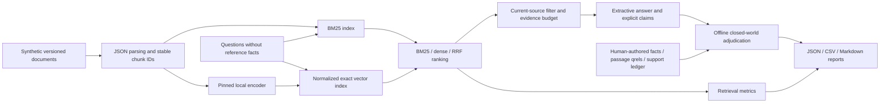
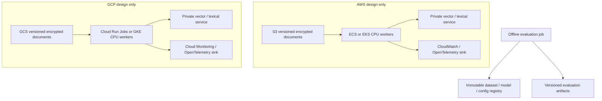

# Enterprise RAG Evaluation Lab — architecture

## 1. Requirements

Evaluate retrieval, reference-fact correctness/completeness, evidence support, citation support, abstention and operational performance independently. Run locally on synthetic data without credentials, paid APIs or cloud resources. Python 3.11 is the target runtime. The verification record explicitly identifies deviations on this machine.

Passage relevance is authored independently of retrieval. Answer facts and claim/evidence judgments are authored independently of extractive generation. Cases cover six operations domains, superseded policies, drafts, active contradictions, duplicates, absent evidence and ambiguous questions. No production accuracy claim follows from this small diagnostic corpus.

## 2. Technology Options

| Component | Options | Consequence |
|---|---|---|
| Lexical | rank-bm25 / local emergency implementation | Small dependency; local variant differs in IDF and is labeled separately |
| Vector | NumPy exact / FAISS CPU / managed vector store | Exact search is sufficient for this corpus; ANN introduces recall and index-training variables |
| Embeddings | MiniLM / larger local encoder / paid API | Small public encoder; no API billing; limited context and language coverage |
| Answer | deterministic extraction / installed local LLM | Extraction isolates evaluation mechanics; no generative-language quality claims |
| Judging | human ledger / lexical similarity / LLM judge | Ledger gives authoritative closed-world decisions; similarity is not factual verification |

## 3. Decision Matrix

Illustrative design scores (1 low, 5 high), not measured benchmark results. Equal weights prioritize local reproducibility.

| Design | Local simplicity | Auditability | Low resource use | Semantic retrieval capability | Sum |
|---|---:|---:|---:|---:|---:|
| BM25 alone | 5 | 5 | 5 | 1 | 16 |
| Exact dense alone | 4 | 4 | 3 | 4 | 15 |
| BM25 + exact dense + RRF | 3 | 4 | 3 | 5 | 15 |
| Managed vector and paid generator | 1 | 2 | 2 | 5 | 10 |

Choose all three local retrieval arms for comparison, rather than treating the largest sum as evidence of best relevance.

## 4. Final Selection

Python, rank-bm25 BM25Okapi, sentence-transformers MiniLM, normalized float32 NumPy exact dot-product search, reciprocal rank fusion and an extractive answer baseline. FAISS is unnecessary at this size. Direct dependencies are pinned in pyproject.toml; a complete transitive hash lock remains a release gate until network installation/audit is available.

Pinned model: `sentence-transformers/all-MiniLM-L6-v2`, revision `c9745ed1d9f207416be6d2e6f8de32d1f16199bf`, CPU, 384 dimensions. The [immutable model tree](https://huggingface.co/sentence-transformers/all-MiniLM-L6-v2/tree/c9745ed1d9f207416be6d2e6f8de32d1f16199bf) lists ~90.9 MB safetensors weights; the whole multi-format repository is larger. Load only safetensors with remote code disabled. The pinned revision is the content identity; dataset SHA-256 digests are recorded separately. [SentenceTransformer documentation](https://sbert.net/docs/package_reference/sentence_transformer/model.html) describes revision selection and embedding normalization.

RRF score for chunk c: `sum(1 / (60 + rank_i(c)))` over complete lexical and dense chunk rankings, ranks starting at one. Score ties sort by stable chunk ID. Collapse sibling chunks by atomic passage ID before applying K. Dense cosine scores are not mixed directly with BM25 scores. Hybrid query latency includes both rankers and fusion; embeddings are not reused from a separately timed dense arm.

## 5. Sizing Calculations

Measured corpus size and index-build timing are in results/metrics.json. At defaults there are 12 documents and 18 atomic passages/chunks. Check generated metadata as the authoritative count if the dataset changes.

Design estimates: normalized vector storage = `N × 384 × 4` bytes; 18 vectors need 27,648 bytes; 1 million need 1.536 GB before metadata/working memory. Exact similarity computation is O(Nd) per query; embeddings and model runtime dominate tiny-corpus footprint. BM25 postings scale with token occurrences; Python object overhead prevents a reliable bytes/token constant without profiling.

Default 64 whitespace-word chunks with overlap 8 remain within atomic passage boundaries. This is not tokenizer-aware. The encoder truncates to 256 wordpieces; larger configured chunks can lose evidence. Inspect tokenizer lengths before changing this bound. Fragmenting one labeled passage gives optimistic any-fragment retrieval credit, documented in reports; independent fragment qrels are required for production chunk optimization.

## 6. Deployment Architecture

The answerer receives only query text and retrieved chunks. It never reads reference files. The evaluator runs after predictions. Fixtures reside separately from qrels and adjudications. Corpus passages are used to author labels by hand; this is a transparent development benchmark, not a blind test set.

AWS and GCP are architectural options only. Keep ingestion, serving and evaluation roles separate; use private endpoints, workload identity, tenant-aware evidence filtering and immutable dataset snapshots. Select managed vector storage only after validating filter semantics, freshness, deletion propagation and approximate recall. No cloud SDK, account or deployment is included.

## 7. Security

All content is authored synthetic technology policy. No secrets, real customer records or credentials are needed. Reports retain OS, architecture, memory/CPU counts, library versions and UTC times, but omit usernames, hostnames and absolute home paths. Model loading disables remote code and forces safetensors. Treat all future retrieved text as untrusted data, including prompt injection and forged authority metadata.

Production controls: enforce ACLs before retrieval, deny cross-tenant results, isolate evaluators from write permissions, encrypt storage/transit, use workload identities, redact sensitive telemetry, sign artifacts and enforce retention/deletion. Never place private inputs in this public repository. Package pins are not proof of security; resolve a hash-locked dependency set and run pip-audit plus a dedicated secret scanner before publication.

## 8. Operational Observability

Record dataset version and SHA-256, seed, model revision, library versions, config, index build duration, peak process RSS, physical memory when available, logical CPUs and timestamps. Report retrieval latency and retrieve-select-answer latency separately; retain every repeated sample. Peak RSS is process-wide and cannot establish per-backend incremental memory.

Production traces should join request, retrieval, policy filter, model version, evidence IDs and claim/citation decisions. Aggregate by domain, authority version, tenant and answerability without logging private text by default. Monitor index/source version lag, empty retrieval, unknown claims, false abstentions, missed abstentions, citation violations and retrieval regressions.

## 9. Failure Modes

| Failure | Detection in lab | Engineering action |
|---|---|---|
| Retrieval miss | Passage qrels absent at K (including partial misses) | Tune segmentation/K; evaluate semantic and lexical combinations |
| Relevant evidence unused | Relevant retrieved IDs absent from selected evidence | Audit selection budgets; authority-aware reranking |
| Incorrect synthesis | Wrong or missing reference facts | Independent fact-completeness review; constrained generation |
| Unsupported claim | No authored support in selected evidence | Require support or abstain |
| Incorrect citation | Cited passage absent from evidence or not supporting claim | Verify each attached citation, not document topic similarity |
| Conflicting evidence | Authored contradiction relations / unresolved active conflict case | Surface conflict and request owner resolution |
| Stale source | Superseded/draft source in evidence or citations | Enforce version authority at ingestion/retrieval |
| Missing evidence / failure to abstain | Unanswerable reference case answered | Answerability calibration and clarification |

Detectors are closed-world diagnostics, not general semantic classifiers. One answer can have multiple failure labels. An irrelevant copied statement may be fully grounded but incorrect for the requested answer. A factually correct claim can have a wrong citation. Stale evidence can support obsolete text while reference correctness is zero.

## 10. SLOs & Runbooks

Proposed production gates, not achieved SLO claims: 100% tenant ACL isolation; zero unsupported high-risk claims in independently reviewed release cases; no regression exceeding 2 percentage points in domain Recall@K; citation precision >= 0.98 on a sufficiently sized held-out set. Illustrative serving budget: warmed p95 retrieval <= 150 ms, answer deadline <= 3 seconds. This tiny serial local benchmark cannot validate those production budgets.

If relevance drops: freeze dataset/model/config, reproduce, inspect category qrels and source versions, compare ranked passages, then tune one factor at a time. If citation correctness drops: stop promotion, inspect attached claim/passage links and evidence selection. If policy conflict is active: abstain and route to source owner. If model fetch fails: stop all-method runs clearly or explicitly select lexical-only mode. If latency increases: inspect query embedding, CPU contention, index size and warm/cold differences before increasing resources.

## 11. Cost Model

No API cost or paid services. Model download and local CPU, disk, memory and energy still consume resources. Monetary estimates require user-supplied unit prices; none are fabricated. Local run cost formula: `(CPU seconds / 3600 × CPU-hour rate) + (RAM GB-hours × RAM rate) + storage + transfer`. Cloud design adds idle replicas, observability, cross-zone transfer and index service costs. Measure full wall time including cold initialization for batch budgets; warmed request samples exclude cold model load.

For Q queries, candidate count N and embedding width d, exact search work grows approximately QNd. Hybrid adds lexical ranking and fusion. Resource comparisons must separate one-time corpus embedding from per-query embedding. At larger scale, benchmark ANN recall loss and shard overhead before claiming savings.

## 12. Trade-offs

An extractive baseline gives deterministic, inspectable claims but cannot synthesize robustly, resolve contradictions or calibrate abstention. Current-source filtering occurs after retrieval and can exhaust an evidence budget. Fixed K increases irrelevant material; duplicates consume ranked slots even when semantically equivalent. RRF avoids score calibration but its constant/candidate depth remain tuning parameters.

The authoritative ledger only recognizes authored claim text. Paraphrases and smaller fragments are counted as unadjudicated, with conservative zeros; this is not verified factual error. Reference-fact precision penalizes true but question-irrelevant facts. Empty claim precision/support is undefined, not 100%; abstention is scored separately. Retrieval scores omit missing/ambiguous cases with no qrels; active-conflict qrels remain scoreable even though the case is not answerable.

Quick mode is the first 10 development questions, so it excludes the hardest missing/conflict cases. Full mode uses all 18. Controlled fixtures always use all 10 cases and are summarized separately. Fixed method order, serial timing, tiny samples and same-corpus development limit generalization. Repeated latency samples are correlated; P95 is descriptive, not an independent confidence interval.

## 13. Scale Evolution

Start with human-reviewed frozen examples and exact search. Add independently authored held-out tenants/domains and real failure adjudication with privacy review. Measure inter-rater agreement and uncertainty. Add stronger evidence selection, source-validity intervals, ACL filters, contradiction detection and calibrated abstention before experimenting with a generator.

For larger corpora, add incremental ingestion, tombstone propagation, cache version keys, ANN shadow comparisons against exact search and concurrent load tests. Keep retrieval labels separate from answer facts and claim-support judgments. Before a local LLM adapter, pin weights/tokenizer/runtime, define prompt and sampling seeds, add prompt-injection tests and separately validate judge behavior. Require canary gates and rollback by dataset/index/model version.
