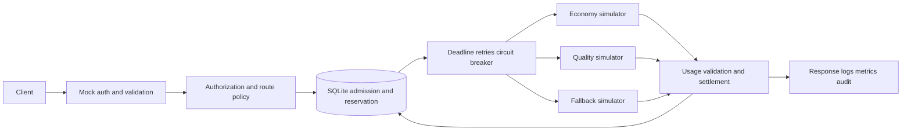
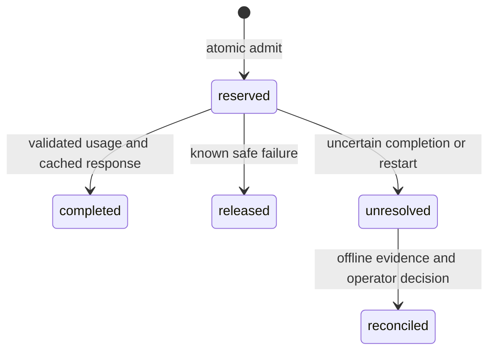

# Architecture review

## 1. Requirements

One executable local gateway: attributable model access, tenant/application budgets, deterministic routing, bounded reliability, durable idempotency, redacted operations and repeatable evidence. No external provider credentials. Local demonstration only, single active process per DB. The HTTP schemas and README define enforceable boundaries.

## 2. Technology Options

FastAPI/Pydantic vs hand-written HTTP: schema validation and OpenAPI justify framework overhead. SQLite vs Postgres: no external service, durable transactions, limited write concurrency. In-memory quota vs Redis: durable local SQLite admission; Redis reserved for scale evolution. Simulated adapters vs real API: deterministic failures and no spend.

## 3. Decision Matrix

| Option | Local reproducibility | Durable accounting | Multiple replicas | Operational burden |
|---|---|---|---|---|
| In-memory only | High | No | No | Low |
| FastAPI + SQLite | High | Yes within documented scope | Unsupported | Low |
| FastAPI + Postgres + Redis | Medium | Yes | Designable | Higher |

## 4. Final Selection

Python 3.11, FastAPI, Pydantic, HTTPX, SQLite, Prometheus client, pytest, YAML config, Docker. Store uses integer money and serialized write transactions. Simulators are pure deterministic functions except for configured per-model intermittent sequence counters and delays. Response text is synthetic and never includes prompt content.

## 5. Sizing Calculations

Planning estimates, not measured production capacity: 10 RPS × 0.1 second latency = one average concurrent request (Little's law); allow 8 for bursts. At 100 input + 50 output tokens/request: 10 × 60 × 150 = 90,000 tokens/minute. This exceeds default local tenant TPM, so the capacity example requires intentional policy changes.

At 10 RPS, 864,000 daily requests × 150 = 129.6 million daily estimated tokens. With economy $0.0001/million, illustrative unrounded API spend is $0.01296/day; per-request one-micro-USD rounding produces at least $0.864/day. Rounding dominates these deliberately tiny prices. Production prices and output distributions must be substituted.

Memory planning: 100 MiB process allowance + 8 × (16 KiB input + 32 KiB object allowance) ≈ 100.4 MiB, excluding framework/allocator variation and SQLite cache. Measure RSS before provisioning; this is an estimate. Five write transactions/request (admission, reservation audit, settlement, completion audit, plus a conservative allowance) × 10 RPS = 50 transactions/second. At an illustrative 2 KiB stored record+indexes/request, ~1.7 GB/day; retention and compaction become necessary. Structured logs at ~150 bytes/request yield ~130 MB/day. Roughly 100 metric series × 150 bytes/sample × 5760 scrapes/day (15 sec) ≈ 86 MB/day before compression. Verify actual cardinality against configured tenants/apps/models.

## 6. Deployment Architecture

The runner binds localhost. Container runs as UID 65534 with a writable named volume. Startup recovery requires exclusive access; never run Uvicorn multiworker or two containers on the same state. SQLite serializes writers; see [SQLite transactions](https://www.sqlite.org/lang_transaction.html). FastAPI supports workers, but process-local breakers and recovery ownership here deliberately restrict deployment to one worker; see [FastAPI worker documentation](https://fastapi.tiangolo.com/deployment/server-workers/).

## 7. Security

Synthetic API keys establish tenant identity only for a local demo. Permissions precede idempotency replay, so revoked model access is not bypassed. Usage/audit queries always filter authenticated tenant; app selection is allowlisted. Prompt and output are excluded from normal logs, errors and audit. The completed response is intentionally persisted in SQLite for replay; protect DB filesystem permissions, backups and retention. SHA256 fingerprints are not anonymization and can reveal equality. No encryption-at-rest or production IAM is claimed. Protect metrics behind operator authentication in production: aggregate telemetry contains business-sensitive attribution. No arbitrary request IDs, prompts or caller IDs are metric labels. A replaceable Screening interface is the explicit PII/content enforcement extension; its default is no-op and not DLP. An ingress body-size limit and TLS belong in the production edge; character validation alone does not bound raw HTTP allocation.

## 8. Operational Observability

Request counters by HTTP status; provider attempts and gateway total latency histograms; bounded event counters for denials, retry, fallback, provider errors and breaker transitions; accepted estimated-token and successful actual-token counters and simulated cost by configured tenant/app/model. Request UUID correlates structured JSON completion logs and audit decisions. Histograms count retries; overhead subtraction is an aggregate diagnostic, not a separate instrumented CPU profile. Metrics reset on restart; durable usage is the ledger authority. No raw prompt/output logging, default Uvicorn access logs disabled.

## 9. Failure Modes

All configured errors are synthetic. 429/500/unavailable are known side-effect-free failures; timeout cancellation is replay-safe only for the pure simulator. Invalid usage does not trigger retry/fallback: hold funds and investigate. Crash after provider return before settlement leaves unresolved; crash after settlement before HTTP return replays completed response. Lost client response with no server cancellation can still settle normally. On cancellation propagation after dispatch retain the hold. Circuit state is volatile and resets on restart. SQLite contention can block the event loop; this deployment is deliberately bounded and not a distributed quota service.

## 10. SLOs & Runbooks

Proposed local objectives: zero overspend under admitted reservations, zero duplicate settlement per tenant/app/key, no prompt leakage in standard telemetry; healthy-path p95 <100 ms at eight benchmark clients. These are local acceptance targets, not production availability commitments. Provider exhaustion is an error, quota and budget rejections are separately reported. Investigate ledger inconsistencies before restoring admission. Detailed procedures in runbooks.md.

## 11. Cost Model

For total tokens T and configured price P micro-USD/million, `ceil(T*P/1e6)` micro-USD. Reservation uses maximum allowed route price and estimated ceiling; settlement uses validated reported input+output and selected route. Each model currently uses the same input/output price. Ledger usage groups by tenant/application; response and model cost metrics supply model attribution. Cost per success = sum settled costs / successful unique requests. Benchmark compares economy, quality and timeout fallback and records reservation/actual distinction. Fallback may cost more, change quality, violate residency or exceed model permissions: filter before reservation and never silently widen permissions. Simulated model charges exclude gateway CPU/storage/network infrastructure and staffing/on-call overhead, which must be budgeted separately.

## 12. Trade-offs

Small inspectable control plane trades throughput for serialized correctness. Conservative holds and no automatic unknown release can deny safe traffic but preserve accountability. Fixed windows can burst at boundaries. Integer rounding exaggerates very low prices. Response caching increases sensitive durable data. Audit and settlement are separate transactions; an audit gap can exist around crash boundaries even when the ledger is durable. See tradeoffs.md.

## 13. Scale Evolution

Replace mock auth with OIDC workload identity and mapped tenant/application grants. Multiple replicas need Postgres transactional ledger with unique idempotency constraints, leases/fencing for reservation ownership, outbox audit delivery, provider idempotency tokens and reconciliation workers. Use Redis atomic scripts for shared RPM/TPM/concurrency leases with explicit failure policy and durable accounting as authority; don't split budget checks and debit. Persist circuit telemetry or use shared health aggregation carefully. Add provider-specific tokenization, input/output prices, residency and retention policy, encrypted response storage, upstream body limits, TLS, secret management, backups, migrations, staged rollout and managed cloud monitoring. Load test real network/provider behavior before any scalability claim.
