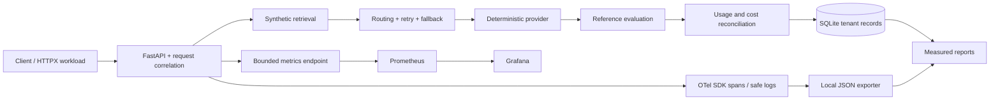

# Enterprise AI platform observability architecture

## 1. Requirements

Observe transport availability, provider behavior, structured answer quality and simulated cost independently. Correlate all via request and trace IDs, never high-cardinality metric labels. Run reproducibly on Python 3.11 without another project, external LLMs or paid resources. Evidence is actual local execution, not a commercial-provider benchmark.

## 2. Technology Options

| Concern | Options | Evaluation |
|---|---|---|
| Request server | FastAPI / Flask | Async typed validation and HTTPX integration favor FastAPI |
| Traces | OTel SDK / bespoke timer | SDK supplies real span context; local allowlisted exporter minimizes dependencies |
| Metrics | Prometheus / log-only | Prometheus gives bounded aggregations, logs preserve detail |
| Records | SQLite / PostgreSQL | SQLite is reproducible locally, limited for multiple writers |
| Quality | Explicit reference labels / model judge | Exact fixture labels remove judge variability; no arbitrary-prose factual guarantee |
| Views | Generated HTML / Grafana | HTML captures experiments, Grafana monitors live API |

## 3. Decision Matrix

Scores 1–5, higher better, equal weights. These are engineering judgments, not measured rankings.

| Design | Reproducibility | Offline operation | Correlation | Local simplicity | Total |
|---|---:|---:|---:|---:|---:|
| Chosen local OTel/Prometheus/SQLite | 5 | 5 | 5 | 4 | 19 |
| Managed cloud suite | 3 | 1 | 5 | 2 | 11 |
| Logs alone | 5 | 5 | 2 | 5 | 17 |

## 4. Final Selection

FastAPI, real OTel SDK parent/child spans, Prometheus client, SQLite, deterministic providers and exact structured-reference evaluator. Dependencies fully version-pinned. Optional Docker Prometheus/Grafana. JSON trace exporter works without a collector; file export is synchronous and unbounded file growth is a known local-only limit. No cross-service tracing claim.

## 5. Sizing Calculations

Planning example, not lab throughput: average 20 RPS, peak 100 RPS; mean service time 0.2 s, incident 0.8 s. Little's law L=λW gives average concurrency 4, peak normal 20, peak incident 80. Four local permits intentionally constrain the lab; scale tests must size queues separately. Workload generator is closed-loop and not an open-loop saturation test.

Healthy trace: nine spans/request (inbound, validation, retrieval, selection, initial wrapper, provider, evaluation, cost, response). Failed requests omit evaluation. Each extra attempt adds wrapper+provider: maximum thirteen spans with three attempts. Plan ten spans/request at 20 RPS = 200 spans/s. At assumed 600 B/span: 120 kB/s, 10.368 GB/day; seven days 72.576 GB before indexing/replication. At 10% sampling: 7.258 GB/week. The lab samples 100%; sampling is a future scaling control, not a current exporter feature.

One safe log/request, assumed 250 B → 5 kB/s → 0.432 GB/day, 3.024 GB/week. Record storage assumed 2 kB/request → 3.456 GB/day. Retain seven days in a production planning example (24.192 GB); local deletion is manual. Combined raw trace/log/record ingest ~165 kB/s, excluding metric exposition and indexes. Two replicas roughly double storage if fully replicated.

Metrics: two routes × up to nine stages × (ten finite buckets + infinity + sum + count + created) = at most 252 histogram series. Request counters: three bounded status profiles × two failure profiles × two series = 12 conservative combinations. Attempts: two model profiles × two statuses × two series = 8. Cost two models × two = 4. Five scalar counters × two = 10. Budget under 300 application series; current emitted combinations are fewer. No arbitrary tenant/application/request/trace values enter labels. At 300 series/5 s = 60 samples/s = 5.184 million/day. At an assumed 16 B/sample raw = 82.944 MB/day; allow 3× indexing/head overhead → ~1.742 GB/week. Recalculate from actual active series before scaling. Labels must remain enums and be reviewed on every addition.

Planning infrastructure cost uses deliberately hypothetical unit rates, not vendor quotes: two 2-vCPU monitoring nodes × 730 h × $0.04/h = $58.40/month; 100 GB disk × $0.10/GB-month = $10; hypothetical ingestion 400 GB/month × $0.50/GB = $200; total $268.40 excluding tax/network/operations. Local incremental paid-service spend is zero; existing hardware/electricity/Docker resources are not priced. Validate actual regional pricing before any cloud design decision.

## 6. Deployment Architecture

API and stages occupy one process. Metrics scraping crosses a service boundary; provider/retrieval do not. FastAPI schema parsing is covered by the inbound span; the request_validation child performs explicit tenant authorization and scenario admission. W3C incoming traceparent is extracted, all stages inherit active context, and a response traceparent is injected. Untrusted context identifies correlation only and never authorizes access. Benchmarks use HTTPX in-process ASGI; live-stack smoke checks separately exercise actual HTTP.

AWS evolution candidate: container workload on ECS/EKS, ADOT collector, managed Prometheus and a governed trace backend. AWS documents Prometheus-compatible ingest and ADOT collection in its [managed Prometheus guide](https://docs.aws.amazon.com/prometheus/latest/userguide/AMP-ingest-with-adot.html). GCP candidate: Cloud Run/GKE, OTel Collector and Managed Service for Prometheus; [official overview](https://docs.cloud.google.com/stackdriver/docs/managed-prometheus) documents these collection options. These are proposed deployment mappings; nothing was provisioned or validated on cloud.

## 7. Security

Implemented: bounded schema inputs, public demo identities mapped server-side to fixed tenants, SQL parameterization, tenant-filtered record reads, payload-free span attributes/logs, loopback host ports, ignored runtime files. No prompts/answers/evidence are persisted. Request IDs and trace IDs are safe synthetic operational metadata. No credentials needed.

Demo keys are not authentication suitable for production. Metrics/export files and Grafana are privileged operator views aggregating tenants. Production recommendations: OIDC/mTLS, authorization on every trace/log/metric query, tenant-scoped views, encrypted storage/transport, audit access logging, secret-managed credentials, network policy and log/trace redaction before egress. The in-memory trace buffer retains at most 10,000 spans. Current tenant isolation is API record filtering, not per-tenant database encryption or hostile-process isolation. Grafana has its default local login and must remain loopback; replace credentials before any shared access.

Seven-day Prometheus retention is configured. SQLite/trace/log retention requires manual operator deletion. In-memory exporter and SQLite memory default are for finite local runs. A fixed-minute in-process tenant rate limiter is implemented (120 RPM in the live server, configurable via LAB_TENANT_RPM; 10,000 RPM in benchmark app instances). It is not distributed enforcement and minute boundaries allow bursts. No automatic retention, durable log pipeline, distributed locks, production quota guarantees or circuit breaker is claimed. Input validation errors must not be ingested wholesale into logs. Uvicorn access logging disabled in supplied commands; other servers need equivalent review. Sensitive raw inputs should not be passed into this synthetic lab.

## 8. Operational Observability

Counters: request status/failure at completed valid provider lifecycle; attempts by model/status including timeouts; retries count additional primary calls; fallback counts fallback invocations; degraded counts quality-failing HTTP 200; cost sums every billed simulated attempt. Timeout rate = timed-out attempts / all attempts. Request error rate = 503 / valid completed requests. Retry amplification = attempts / requests (includes fallback); retries/request and fallback requests/request have separate denominators. Transport success = HTTP 200 / valid completed requests. Quality success = passing evaluations / HTTP 200. Rejection rate = ai_rate_limit_rejections_total / ai_admission_attempts_total, where admission attempts include authenticated schema-valid configured requests, including rejected requests. Rejected requests have inbound/admission spans and safe status logs but no billed provider attempt or SQLite record. The quota is enforced within one event loop over two bounded tenant profiles. Breaker absent; invalid/auth HTTP responses have inbound spans but are excluded from workload SLIs and completed-request counters. This prevents conflating malformed clients with provider reliability, but requires a separate edge HTTP metric in production.

Stage histograms record provider summed attempt duration, retrieval/evaluation, queue wait, residual application overhead and application lifecycle total. Request parsing/middleware/client-network latency are excluded from that total. Benchmark throughput uses actual HTTPX batch wall time. Report percentiles use exact nearest rank over measured observations; Grafana histogram_quantile interpolates bucket counts and is an approximation. The two percentile methods need not match. No real streaming or commercial model TTFT claim: /stream measures scheduled first emission; HTTPX ASGI buffers the response. Queue wait is bounded by controlled workload concurrency only; the local fixed-minute quota also rejects excess valid admissions, but has no distributed coordination.

Seven measured report views are generated in dashboard.html. Live Grafana uses current API metrics, not offline benchmark snapshots. Traces and detailed request/cost records supply tenant/model/app attribution; metrics do not contain tenant labels. Repeated failures need both high-level counters and exact attempt traces to explain cost amplification.

## 9. Failure Modes

Ten configured scenarios are recorded with triggers, expected vs actual outcomes, relevant traces, SLO calculations and responses in results/failure_analysis.md. Timeouts consume input tokens by explicit simulation policy, not real billing inference. Retries are bounded at three total attempts; fallback occupies the third attempt. Recovery restores healthy fixture behavior, not historical error budgets. Unsupported answers and wrong citations remain HTTP 200 and trip quality alone; monitoring transport alone misses them.

## 10. SLOs & Runbooks

Measurement window: complete bounded experiment for benchmark SLOs. All scenarios and runs are included. Excluded: warm-up, stream-only path, validation/auth errors, and 429 quota rejections (separately measured by admission counters). No outages are hidden by dropping provider failures. Proposed production SLO window: trailing 30 days, to be implemented against persistent events before production. Current benchmark is not a 30-day compliance claim.

| Objective | Eligible denominator | Good numerator | Target |
|---|---|---|---|
| Availability | Valid accepted /query requests | HTTP 200 | 99% |
| Latency | Same, including failed provider requests | HTTPX ASGI round-trip time ≤80 ms | 95% |
| Quality | HTTP 200 labeled requests | All quality criteria pass | 95% |
| Cost guardrail | Valid accepted /query requests | Simulated actual cost ≤$0.001 | 99% |

Good/eligible is SLI. Allowed bad = eligible×(1-target). Consumed budget = bad/allowed bad; remaining = allowed bad−bad (negative means exhausted). Empty populations return unavailable SLI, not 100%. Benchmark latency SLO uses client-observed ASGI round-trip time; direct API records fall back to lifecycle time and must not be combined into one production SLI. Latency may pass for a fast failure; availability must be read independently. Quality denominator excludes 503, so pair it with availability. Cost objective is a per-request guardrail, not a dollar budget for total demand. Reference labels limit eligible quality population; production correctness without labels is unavailable.

Synthetic burn events: one equally weighted event/minute; windows (end−window,end]. Burn = window bad fraction/(1−0.99). Page iff 5-minute AND 60-minute burn ≥14.4. Ticket iff 30-minute AND 360-minute burn ≥6. Short-window spikes alone do not trigger page. Dataset has 300 healthy then 60 bad minutes, followed by 360 recovery minutes. Both paired windows share the same end time and eligibility; no production alert delivery/validation claim. Workload recovery and synthetic alert recovery are separate experiments.

Runbooks: provider spike→compare retrieval vs provider spans; timeout→limit retry budget; fallback→check cost and latency before expanding; unsupported/citation issue→hold affected answer path and fix evidence policy; tenant spike→investigate tenant records and add a token/cost quota before production; recovery→confirm quality, cost and long-window burn before resolving. No automatic fail-closed quality gate exists in this observability lab; failures deliberately remain visible.

## 11. Cost Model

Price config uses dollars per million synthetic input/output tokens. Attempt actual = (input×input price + output×output price)/1e6. Primary prices 1/2; fallback 4/8. Healthy 100 input+30 output costs $0.00016. Primary timeout bills 100 input, zero output: $0.00010. Fallback request: two primary timeouts + one fallback success = $0.00084. Initial estimate assumes one successful primary attempt; reconciliation retains actual simulated cost. Retry scenario has two timed-out primary calls then success = $0.00036. Tenant spike uses 3000 input = $0.00306. These are invented configurable tariffs, not provider billing.

Cost CSV includes each request, successful-request subset, tenants, applications and models. Dimension totals are alternative views and must not be added together. metrics.json separately reports additional-attempt and fallback attempt cost. Failed requests still consume cost; cost per success can be reported as successful subset cost/successes or all platform cost/successes, with the choice explicit. The CSV's successful_request dimension contains only successful requests; total platform cost divided by success count includes failure waste.

## 12. Trade-offs

Deterministic semantic atoms enable exact unit tests but do not generalize to natural-language quality. Synchronous exporter and SQLite simplify local reproduction but add overhead and single-writer constraints. No external provider network, tokenizer, embedding index, production auth, distributed quota, breaker or automated incident response is modeled. Fixed sleeps demonstrate scheduling, not model serving speed. Small closed-loop samples and mixed incident traffic intentionally fail SLOs; they are not representative fleet averages. No fabricated screenshots or latency claims.

## 13. Scale Evolution

Separate gateway/retrieval/evaluation processes and propagate HTTP/gRPC context before claiming distributed execution. Introduce durable event ingestion, OTLP batch export, bounded queues and shedding, relational/columnar accounting, async evaluation with explicit sampling bias, representative labeled review sets, tokenizers/provider reconciliation and multi-tenant authorization. Scale telemetry independently with retention, tail sampling and cardinality budgets. Validate open-loop load, worker isolation, data retention and multi-window alerts against replayed production-like traffic before any production readiness claim.
