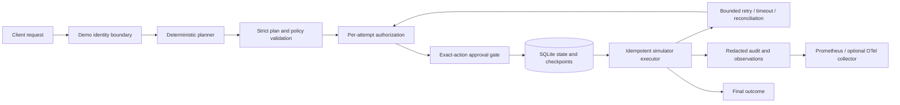
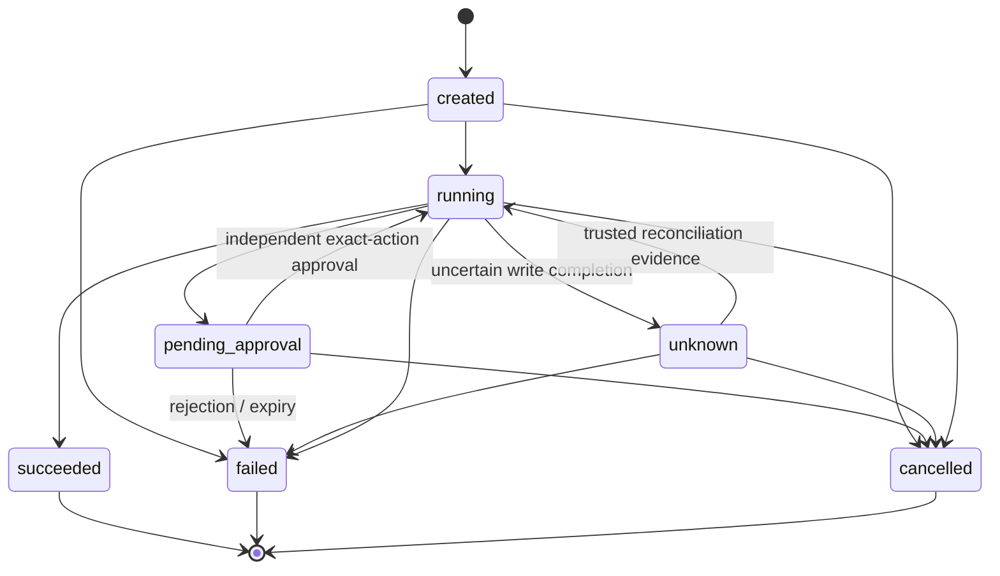

# Enterprise AI Agent Reliability & Governance Lab

## 1. Requirements

Execute multi-step typed plans under tenant/role/tool policy; bound depth, retries, deadlines and estimated/runtime cost; gate high-impact actions on independent time-limited approval; persist state before tool invocation; preserve idempotency and auditability on retry/restart. Demonstrate denial, duplicate delivery, timeout, partial failure, unknown completion and malicious retrieved content. No real tools, paid models or cloud resources. A deterministic planner deliberately removes model intelligence as a confounder.

Acceptance is automated tests plus A–M scenarios (N–P add response validation, partial failure and permanent failure), repeated measurements and independent artifact arithmetic checks. Scope is a single local serialized executor, not an enterprise-ready service.

## 2. Technology Options

Python/FastAPI versus a workflow framework: the small explicit implementation makes safety boundaries inspectable. SQLite versus PostgreSQL: SQLite avoids external services and supports local durability; PostgreSQL offers row leases, multi-worker concurrency and tenant row policies. A durable workflow engine can supply timers/replay at scale, but still needs tool authorization and external idempotency contracts. Deterministic fixtures replace paid model calls. Prometheus offers low-cardinality operational measures; OpenTelemetry spans supply execution/tool tracing hooks.

## 3. Decision Matrix

Scores 1–5, higher is better. Weights are illustrative design judgments, not measured benchmarks.

| Option | Local reproducibility (0.4) | Explicit controls (0.3) | Scale (0.2) | Low operational cost (0.1) | Weighted score |
|---|---:|---:|---:|---:|---:|
| SQLite explicit engine | 5 | 5 | 2 | 5 | 4.4 |
| PostgreSQL explicit engine | 3 | 5 | 4 | 3 | 3.8 |
| Managed workflow service | 2 | 3 | 5 | 2 | 2.9 |

## 4. Final Selection

Python 3.11, strict Pydantic models, FastAPI, HTTPX/pytest, SQLite WAL, pinned Prometheus/OpenTelemetry libraries. Modules separate `models`, `policy`, `tools`, `state`, `engine`, `app`, and `experiments`. Request keys are unique per tenant and bound to request hashes. Step keys derive from immutable execution ID and step ordinal; effect ledger keys are tenant scoped. All timestamps/deadlines/approval expirations are persisted. There is one shared process lock around execution mutations. Run exactly one API process and worker. SQLite unique keys and the simulator effect ledger add defense, but the process lock is not a distributed execution lease.

## 5. Sizing Calculations

Illustrative capacity assumptions, not measured capacity: arrival λ=10 workflows/s; four average steps; 5% extra tool attempts; 80% no approval with 0.4 s active duration; 20% approval with 0.4 s active duration and 300 s mean wait. Tool calls/s = 10×4×1.05 = 42. Active concurrency by Little's law = 10×0.4 = 4. Pending approvals = 10×0.2×300 = 600. Total resident logical workflows ≈604, though serialized SQLite cannot be assumed to serve that load.

At a conservative 5 logical durable mutations per tool attempt plus 4 workflow records/transitions: 42×5+10×4=250 logical row writes/s. Actual SQLite commits/pages/WAL bytes differ; these are planning proxies. Retry overhead = 2 additional tool calls/s; amplification=1.05. At six audit events per workflow and 1 KiB/event, audit volume = 60 KiB/s = 5.31 decimal GB/day. At 12 telemetry observations/workflow and 250 B/event, telemetry =30,000 B/s=2.592 GB/day. Seven-day raw audit retention ≈37.16 GB, plus indexes, WAL and backups. Use a 2× reserve (500 logical writes/s, 84 tool calls/s) and load-test storage/tail latency before selecting infrastructure. Approval arrival and expiry distributions can dominate queue size even with fast tools.

Executed local sizing evidence is results/metrics.json; it records SQLite/architecture/Python, throughput and latency. It does not validate the illustrative 10/s enterprise target. Benchmark audit_bytes counts event/detail payload characters for ASCII fixtures, not actual database size; telemetry event count is a storage model input rather than measured network bytes.

## 6. Deployment Architecture

Every transition is validated by an explicit edge map; tests exhaust every pair. Pending, unknown and terminal execution run calls are side-effect-free. Crash after effect commit but before receipt yields a replay-safe read of the same ledger for idempotent tools. Non-idempotent steps found executing after restart become unknown. Explicit reconciliation reads trustworthy adapter evidence; missing evidence blocks automation. No execution parameter editing endpoint exists. Cancellation stops subsequent steps, not a remote already-started action; serialized execution means the local API cannot preempt an active call.

## 7. Security

Public fixture identities represent two synthetic tenants and reader/operator/approver roles. No real authentication, secrets or live enterprise endpoints. Production requires verified workload/user identity and authoritative current entitlements. Initial plan validation prevents partial side effects from a later unauthorized tool; each attempt rechecks policy, including retries and resumes. Prohibited deployment-update plus pipeline-rerun combinations fail before execution. Depth and runtime retries are bounded; estimated initial cost and incremental attempt cost are admitted separately. Execution owner role is persisted and callers cannot elevate it on resume; production requires role revocation lookup, not a stored role claim.

Approval binds SHA-256 over the full strict action (including simulator fault), persists approver/expiry, requires a distinct approver subject in the same tenant, and rejects changed parameters. Approvals never authorize other steps. Expired approval and deadline prevent execution; timers require calls to approve/recover rather than a background sweep. There is no tenant selector in tool arguments and effects are keyed by tenant. Synthetic resource names are validated by a bounded allow-pattern. Retrieved content is never parsed into executable instructions. Deterministic malicious-output fixtures test this narrow boundary, not arbitrary prompt injection. Audit and persisted step output redact token-like fields and email addresses; redaction is a demonstrator, not a full DLP system. Raw simulator effect content remains local synthetic data.

Tools declare risk, schema, permission, retry safety, idempotency and approval. Only explicit reversible tools support compensation. High-impact compensation is denied rather than implicitly inheriting approval. Simulated notification/ticket compensation toggles a ledger flag; it cannot unsend a real notification. No arbitrary shell/network tool or credential handling exists. Tenant-scoped API errors avoid exposing other-tenant IDs. Metrics are operator surfaces, not tenant APIs; never expose them publicly. The demo has no rate limiter and stores unbounded local audit until manual retention. Bound server access and use only synthetic input.

## 8. Operational Observability

Durable observations record completion (1/0), step failures, tool latency, retry count, approval virtual wait at decision/expiration, policy denials, duplicate attempts, recovery outcomes and cost persisted per execution. Prometheus labels are bounded tool and event/kind values; execution IDs appear only in logs/audit/traces. GET /metrics reconstructs counters/histograms from durable observations; this is acceptable for a small lab but has O(history) scrape cost. Completion numerator is successful terminal executions; denominator terminal success/failure observations. Cancelled executions are audited; exclude cancellation explicitly in SLO calculations. Step failure rate is failed attempts/attempts, not failed unique steps.

OpenTelemetry workflow/tool spans are emitted through the API tracer; no exporter/provider is installed by default, so default spans are no-op. The automated OTel test installs an in-memory SDK exporter and verifies parent/child span and execution-ID correlation. An operator can configure an SDK provider/exporter before creating the engine; no trace export is claimed as executed evidence. Audit records are correlated structured durable logs (execution ID, sequence, event, time, redacted JSON detail), exposed through tenant-checked audit API and a compact synthetic JSONL example. No raw request bodies are logged. Simulated execution cost resides in execution rows and benchmark aggregates; observe DB totals for live cost accounting.

## 9. Failure Modes

Transient read/idempotent failure retries at base×2^(attempt−1), maximum two retries by default, deadline and cost rechecked before each attempt. The tools simulate timeout deterministically; no blocking network adapter exists and no hard thread-kill timeout is claimed. A real adapter must enforce socket deadlines and distinguish not-started from unknown write completion. Permanent and invalid output failures stop immediately. Unknown writes never auto-retry; ledger evidence allows reconciliation, otherwise operators investigate. Duplicate request key plus mismatched hash returns conflict; identical delivery returns the existing execution without repeated effects. Initial policy failures have no execution; API admission-denial observations preserve counts.

Crash injection occurs after effect commit and before receipt. Automated tests include abrupt os._exit in a separate process, followed by reopening SQLite. This checks durable restart recovery within one host, not disk loss, split brain or remote service atomicity. Partial workflows keep completed effects; explicit reversible compensation is a separate audited operation. Retry storms are bounded per workflow; global retry budgets/circuit breakers are future work. Concurrent processes are outside the lab's safety contract.

## 10. SLOs & Runbooks

See runbooks.md for numerator, denominator, windows, exclusions and incident procedures. Targets are illustrative objectives, not demonstrated production guarantees. Lab expected-outcome accuracy is separate from workflow success rate: intentional denied/rejected/failed experiments count as correct experiment outcomes but not successful business workflows.

## 11. Cost Model

config/example.yaml contains synthetic prices in arbitrary cost units: planning=0.001 per workflow, tool=0.002 per attempt, state_write=0.000001 per logical mutation, audit_byte=0.000000001 per payload byte, telemetry_event=0.0000001 per observation. No real provider prices/charges are implied. Runtime execution budget charges planning plus attempted tools; persistence/audit/telemetry are separately modeled infrastructure proxies, excluded from that control budget. With W workflows, A attempts, S logical state writes, B audit bytes and T telemetry events: C=W×Pplan+A×Ptool+S×Pstate+B×Paudit+T×Ptelemetry. Retry cost=(A−attempted unique steps)×Ptool. Planning calls=W (deterministic simulator, zero real model calls). State writes are estimated in sizing, not measured disk I/O. Audit and telemetry counts come from executed evidence.

Example using section 5: 864,000 workflows/day; 3,628,800 tool attempts/day; planning/tool cost=864+7,257.6=8,121.6 simulated units/day. State proxy 21,600,000 writes/day=21.6 units. Audit proxy 5,308,416,000 B/day=5.308416 units. Telemetry 10,368,000 events/day=1.0368 units. Retry incremental tool cost=172,800×0.002=345.6 units/day. Approval delay adds 0.2×300=60 s mean waiting time per incoming workflow, and ≈600 concurrent pending approvals; human labor price is intentionally unspecified. It affects end-to-end latency and capacity even without a model bill.

## 12. Trade-offs

SQLite and a serialized executor provide inspectable local crash semantics at the cost of distributed availability and throughput. Simulator-ledger transactions do not carry over to external services: use service-side idempotency keys, transactional outbox/inbox, status lookup and explicit unknown states. A deterministic planner makes control tests reproducible but cannot evaluate open-ended model planning quality. Strict arguments and inert output demonstrate a security boundary without solving prompt injection generally. Local demo identity headers bypass authentication; the architecture is a learning artifact, not deployable production security. Reconciliation trusts only this simulator ledger, not an operator's arbitrary completion assertion. Real compensation is business-specific and may need fresh approval.

## 13. Scale Evolution

AWS: replace demo identity with verified OIDC/workload roles, persist tenant-scoped workflow state in RDS PostgreSQL, queue steps through SQS with deduplication/visibility leases and a transactional outbox, run leased workers on ECS, export OTel to an approved collector and audit to encrypted retention-controlled S3. GCP: verified identity/IAM, Cloud SQL PostgreSQL, Pub/Sub delivery with durable inbox/leases, Cloud Run workers and Cloud Storage audit retention. Queue delivery does not create exactly-once external effects. Both require bounded per-tenant admission, global retry budgets, circuit breakers, approval timer service, encrypted backups/restore tests, network egress restrictions, immutable audit, entitlement revocation, reconciliation adapters and multi-worker fault testing. Benchmark representative workloads and failure distributions before selecting capacity. No resources are provisioned here.
