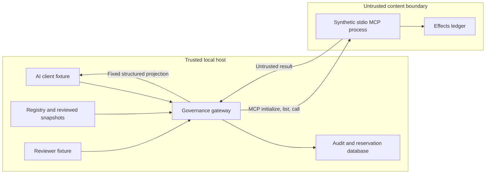
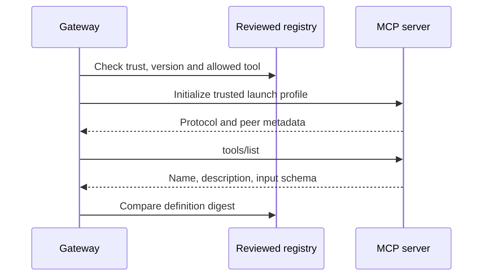
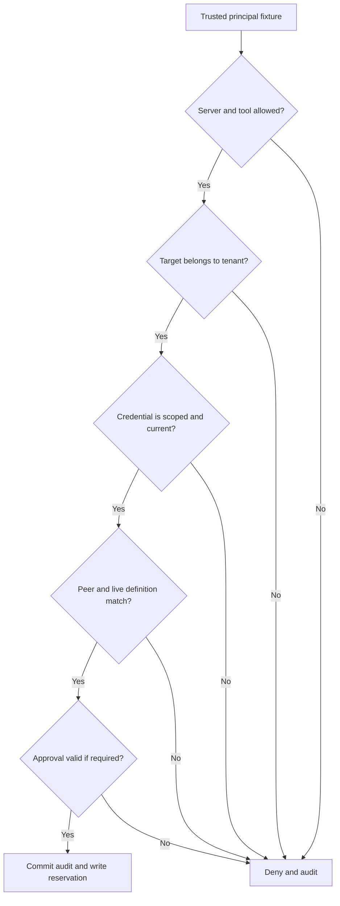
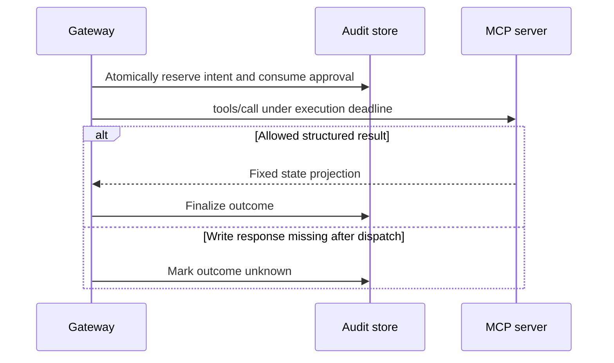

# Architecture review

## 1. Requirements

Use MCP discovery and execution for synthetic enterprise operations. Gate execution on approved server configuration, tool definition, principal, tenant, credential scope and, for high-impact actions, single-use approval. Preserve evidence across uncertain write completion and deny repeats of the same business intent.

## 2. Technology Options

Stdio provides a subprocess fixture suitable for repeatable local tests. Streamable HTTP supports remote deployment and requires service identity, transport authentication and session isolation. SQLite supports transactional local approval and deduplication. PostgreSQL supports shared decisions across replicas. A typed Python API allows direct fixture-based tests. A network API would need authenticated host identity and a separate reviewer surface.

## 3. Decision Matrix

| Option | Local reproducibility | Transactional writes | Multi-host suitability | Selection |
| --- | --- | --- | --- | --- |
| SDK stdio | High | Tool dependent | Low | Lab transport |
| SDK Streamable HTTP | Medium | Tool dependent | High | Deployment option |
| SQLite | High | High, one writer | Low | Lab state |
| PostgreSQL | Medium | High | High | Scale option |
| Typed Python gateway | High | Via store | Low | Lab client surface |
| Authenticated gateway API | Medium | Via store | High | Deployment option |

## 4. Final Selection

Python 3.11+, MCP SDK 1.30.0 over stdio, MCP revision 2025-11-25, Pydantic policy and credential models, JSON Schema validation, SQLite, pytest, structured SQLite audit events and Prometheus text export. A reviewed configuration file defines the registry and tool snapshots. Startup checks registry records and schema validity. Each permitted request compares the returned definition against its reviewed snapshot.

## 5. Sizing Calculations

Illustrative steady-state inputs are 25 tenants, 20 servers per tenant, 12 tools per server and a 10-minute fleet refresh. That yields 500 logical registrations, 6,000 tool records and 500 / 600 = 0.83 refreshes/s. The lab performs request-time discovery. At 100 calls/s that adds up to 100 lists/s and approximately 1,200 advertised definitions/s. A 20 KiB list response implies roughly 2 MiB/s of discovery traffic.

At 100 calls/s and a 200 ms mean residence time, Little's Law gives 20 concurrent in-flight requests. A 3× spike needs about 60 slots at the same residence time. If each busy session carries four calls, this corresponds to 5–15 busy sessions exclusive of idle overhead. Budget at least 100 authorization evaluations/s, or 300/s at peak, plus reviewer operations.

A 1% approval rate yields 1 request/s. At a 15-minute mean wait, backlog is 900 requests. At four human review minutes each, sustained demand requires 240 concurrent reviewers. Audit at two events per call produces 17.28 million events/day. At 600 bytes/event that is 10.368 GB/day, 311.04 GB for 30 days and 622.08 GB at a 2× indexing/replication factor. This upper-bound dispatch estimate excludes reviewer events. At 1% trace sampling and 2 KiB per retained request, traces add about 177 MB/day.

## 6. Deployment Architecture

The subprocess uses the same OS account with a distinct effects database file. The diagram marks the content boundary. In deployment, place the tool process under a separate workload identity with filesystem and egress policy.

## 7. Security

The gateway derives tenant ownership from the target map. A fresh authorization and definition comparison precede dispatch. The SQLite reservation transaction consumes approval and records dispatch intent. Trusted launch selection determines peer provenance in this lab. Advertised peer metadata supplies an additional consistency check.

## 8. Operational Observability

Track registry rejection, definition drift, tenant mismatch, approval outcome, dispatch, final state and correlation ID as structured records. Scrape exported counts without principal or target labels. Benchmark reports separate policy validation, live discovery, tool RPC and total request latency. Retain the fixture effects ledger separately for verification.

## 9. Failure Modes

| Failure | Gateway action | Recovery |
| --- | --- | --- |
| Unapproved / unavailable server | Block dispatch | Verify registry and process health |
| Changed server or definition | Deny and preserve approved snapshot | Review and roll forward versioned policy |
| Invalid identity, tenant or credential | Deny | Fix host principal and scoped issuance |
| Expired/replayed approval or repeated intent | Deny | Review lifecycle and prior receipt |
| Untrusted response | Quarantine output | Review server behavior and suspend trust if warranted |
| Read deadline | Classify timeout | Retry only after recovery and under a new budget |
| Write deadline / missing response | Keep reservation and classify unknown | Reconcile downstream receipt before any new dispatch |

## 10. SLOs & Runbooks

Illustrative objectives are p95 under 200 ms for warm allowed requests, complete terminal audit records for 99.9% of completed gateway requests, and reconciliation of uncertain high-impact operations within 15 minutes. Track these separately from denied calls, offline approvals and initialization. See [runbooks](runbooks.md).

## 11. Cost Model

Illustrative assumptions in USD per 30-day month: three registry/policy replicas at 0.05/hour = 108; ten shared MCP worker slots at 0.08/hour = 576; 259.2 million calls at 0.00001 incremental execution cost = 2,592; 622.08 GB audit at 0.025/GB-month = 15.55; 5.31 GB sampled traces at 0.10/GB-month = 0.53; 311.04 GB audit ingestion at 0.10/GB = 31.10. Illustrative infrastructure subtotal is 3,323.19 before networking, backups and taxes. Rates are inputs to the model.

At 1 review/s and four minutes each, 2.592 million reviews/month consume 172,800 reviewer hours. At 40/hour that is 6.912 million/month. Reduce high-impact request volume through approved workflow design and use measured reviewer effort to revise the forecast. Fixed replica costs scale in steps, while calls, audit and staffing typically scale with tenant activity. Local evidence measures timing and throughput, with a separate quick-run CPU and peak RSS observation. Local energy and monetary cost were unmeasured.

## 12. Trade-offs

Per-request discovery reduces exposure to stale definitions and adds a round trip. Exact description hashing catches benign edits as well as material ones. One-time approval makes replay difficult at the gateway and requires reapproval for a corrected dispatch. Write reservations favor preventing duplicates while holding unresolved intents for reconciliation. A strict output projection deliberately discards most tool output.

## 13. Scale Evolution

Use authenticated remote workloads, reviewed catalogs distributed by version, per-tenant authorization and bounded connection pools. Introduce scoped workload credentials and an auditable reviewer UI tied to a corporate identity provider. Move approval, reservation and audit intent into a shared transactional store, then export audit asynchronously. Require server-side receipt lookups and stable idempotency with explicit reconciliation before automated write recovery. Measure drift refresh intervals and capacity with multiple tool-server replicas.
